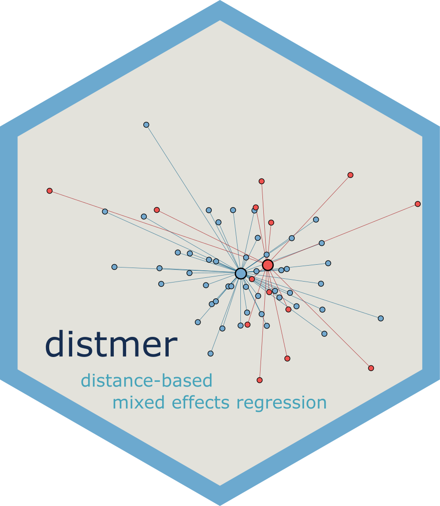

# distmer 

<!-- badges: start -->
[](https://github.com/marine-ecologist/distmer/actions/workflows/R-CMD-check.yaml)
<!-- badges: end -->

## Distance-based mixed-effects models for ecological communities

**Use the ecological distance that fits the question. Describe the sampling
design the way it was collected. Permute at the level where replication
actually lives.**

`distmer` extends the logic of PERMANOVA into a mixed-model workflow. It uses
familiar `lmer`-style formulas for fixed effects, experimental units, nesting,
blocks, repeated observations, and random slopes:

```r
community_distance ~ treatment + (1 | site)
```

The response is a dissimilarity matrix rather than a single measured variable.
`distmer` applies the model to its Gower-centred distance space and constructs
the denominator and permutation rule implied by the sampling design.

It is not a likelihood or REML wrapper around `lme4`. With no random terms, a
supported model reduces to conventional PERMANOVA; for a univariate Euclidean
response, supported mixed designs reproduce their classical linear-model
counterparts.

## A first model

The package works directly with distances produced by
[`vegan`](https://vegandevs.github.io/vegan/). This example asks whether plant
community composition differs among management regimes in the `dune` data.

```r
library(distmer)
library(vegan)

data(dune, dune.env, package = "vegan")
bray <- vegdist(dune, method = "bray")

fit <- permanova(
  bray ~ Management,
  data = dune.env,
  permutations = 9999,
  seed = 2026
)

summary(fit)
```

The result reports the ecological effect being tested, its pseudo-\(F\),
permutation p-value, attainable permutation space, and the exchangeability
assumptions used for inference.

For a repeated or grouped field design, add the independent sampling unit in
the same way you would in a mixed model:

```r
fit <- permanova(
  community_distance ~ treatment + (1 | site),
  data = field_design,
  permutations = 9999,
  seed = 2026
)
```

Observations from a site remain together when the treatment is replicated
among sites. Adding a random term does not manufacture replication: the
formula must reflect how treatments were assigned and samples were collected.

## From field question to formula

| Ecological question | Formula |
|---|---|
| Do communities differ among groups? | `d ~ habitat` |
| Does treatment matter after an environmental gradient? | `d ~ treatment + depth` |
| What is the treatment effect with repeated samples per site? | `d ~ treatment + (1 \| site)` |
| At which level of a nested survey does an effect occur? | `d ~ treatment + (1 \| region/site)` |
| Was treatment randomized within blocks? | `d ~ treatment + (1 \| block) + (1 \| treatment:block)` |
| Do sites differ in their temporal response? | `d ~ time + (1 + time \| site)` |

`permanova()` checks whether the declared design falls inside a validated
inference envelope. Unsupported or confounded structures stop with an
explanation instead of receiving a convenient but unjustified denominator.

## Location, dispersion, and comparisons

A location result should be considered alongside multivariate dispersion. The
dispersion companion uses the same formula-and-data style:

```r
keep <- dune.env$Management %in% c("NM", "SF")
two_group_env <- droplevels(dune.env[keep, , drop = FALSE])
two_group_bray <- vegdist(dune[keep, ], method = "bray")

spread <- permanova_dispersion(
  two_group_bray ~ Management,
  data = two_group_env,
  permutations = 9999,
  seed = 2026
)
```

The package also supports planned and pairwise contrasts, multiplicity
adjustment, Type I/II/III fixed-effect hypotheses, unbalanced sampling, nested
and crossed designs, and validated random-slope models. The guides introduce
these in ecological language before exposing implementation details.

## Installation

Install the development version from GitHub:

```r
install.packages("remotes")
remotes::install_github(
  "marine-ecologist/distmer"
)
```

`distmer` is currently on the `0.9.0.9000` development line leading to the
first stable `1.0.0` release.

## Start with the guides

1. `vignette("getting-started", package = "distmer")` — the distance-based
   mixed-model idea and a first analysis.
2. `vignette("random-effects", package = "distmer")` — repeated sites, nested
   sampling, blocks, hybrids, and random slopes.
3. `vignette("dispersion", package = "distmer")` — distance geometry and
   multivariate dispersion.
4. `vignette("contrasts", package = "distmer")` — planned comparisons,
   pairwise tests, and multiplicity control.
5. `vignette("fixed-effects", package = "distmer")` — Type I, II, and III
   fixed-effect questions.
6. `vignette("unbalanced-mixed", package = "distmer")` — unequal cells,
   missing visits, and unit weighting.
7. `vignette("validation", package = "distmer")` — reference agreement,
   simulations, and reproducible reporting.

## Built to be checked

Supported analyses are tested against `vegan`, classical scalar analogues,
direct matrix calculations, exact permutation enumeration, and adversarial
simulation. Distance diagnostics retain and report non-Euclidean geometry
rather than silently changing it.

For the detailed evidence and current support boundary, see
[`inst/VALIDATION.md`](inst/VALIDATION.md) and
`permanova_capabilities()`.
