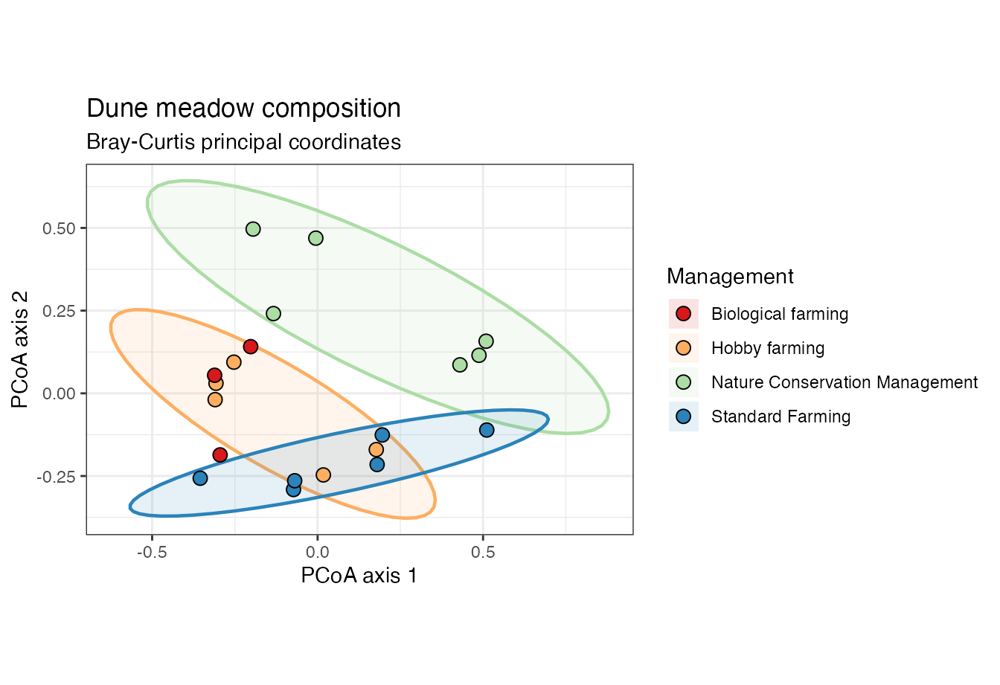

# 1. Getting started with distmer

## What is distmer?

`distmer` is a framework for **distance-based mixed-effects models with
permutational inference**. It combines two ideas that are already
familiar to many ecologists:

1.  PERMANOVA’s partitioning of community variation in the space defined
    by a chosen dissimilarity; and
2.  mixed-model formula notation for describing fixed effects,
    experimental units, nesting, blocks, repeated sampling, and random
    slopes.

The formula looks like an `lmer()` formula, but `distmer` is not a
likelihood or REML wrapper around `lme4`. It works from a dissimilarity
matrix. Fixed terms describe the ecological effects of interest; random
terms identify the experimental units and covariance strata that
determine a valid denominator and permutation action.

This gives two useful reference points:

- without random effects, a supported `distmer` model reduces to
  conventional PERMANOVA;
- with a univariate Euclidean response, supported designs reproduce
  their classical linear- or mixed-model tests.

The aim is therefore not to detach the method from PERMANOVA. It is to
make distance-based inference within a mixed-model workflow while
keeping the denominator and exchangeability assumptions visible.

## Why use distmer?

A typical methods sentence says:

`Differences were tested using PERMANOVA with Bray–Curtis dissimilarities and 999 permutations.`

This omits nearly everything needed for reproduction:

- data transformation
- zero handling
- fixed/random factor status
- nesting and crossing
- Type I, II or III SS
- contrast coding
- denominator
- raw-data or residual permutation
- reduced or full model
- permutation unit
- block restrictions
- exact versus sampled permutations
- treatment of interactions
- handling of missing cells
- “999 permutations” describes the number of draws, not the inferential
  procedure.

The main contribution of `distmer` is not just
`putting an lmer-like formula in front of PERMANOVA`, but making
formerly implicit inferential decisions explicit, inspectable and
testable.

## Example: a dune meadow community model

The
[`vegan::dune`](https://vegandevs.github.io/vegan/reference/dune.html)
data contain plant abundances from 20 Dutch dune meadows (Jongman et
al. 1987):

``` r

data(dune, dune.env, package = "vegan")
bray <- vegdist(dune, method = "bray")
head(dune.env)
#>    A1 Moisture Management      Use Manure
#> 1 2.8        1         SF Haypastu      4
#> 2 3.5        1         BF Haypastu      2
#> 3 4.3        2         SF Haypastu      4
#> 4 4.2        2         SF Haypastu      4
#> 5 6.3        1         HF Hayfield      2
#> 6 4.3        1         HF Haypastu      2
```

From this data we can ask: “Does community composition differs among
management regimes?”

The principal coordinates analysis (PCoA) suggests that dune-meadow
plant composition differs among management regimes: Nature Conservation
Management samples mostly occupy the upper part of the ordination
(positive PCoA axis 2), Standard Farming samples occur primarily at
negative values on PCoA axis 2. Biological and Hobby Farming samples
overlap strongly on PCoA axis 1, suggesting relatively similar plant
assemblages, while Hobby Farming extends toward the lower centre,
indicating transitional composition. Nature Conservation Management
shows the greatest spread, occurring at both negative and strongly
positive values on axis 1, indicating high heterogeneity among meadows.
Standard Farming is also dispersed along PCoA axis 1 but comparatively
consistent on PCoA axis 2. (Note: Biological Farming lacks an ellipse as
n=3)

``` r

points <- as.data.frame(cmdscale(bray, k = 2))
names(points) <- c("Axis1", "Axis2")
points$Management <- factor(
  dune.env$Management,
  levels = c("BF", "HF", "NM", "SF"),
  labels = c(
    "Biological farming",
    "Hobby farming",
    "Nature Conservation Management",
    "Standard Farming"
  )
)

ggplot(points, aes(Axis1, Axis2, fill = Management)) +
  stat_ellipse(
    aes(colour = Management),
    type = "norm",
    level = 0.8,
    geom = "polygon",
    alpha = 0.12,
    linewidth = 0.8
  ) +
  geom_point(size = 3, shape = 21) +
  labs(
    title = "Dune meadow composition",
    subtitle = "Bray-Curtis principal coordinates",
    x = "PCoA axis 1",
    y = "PCoA axis 2"
  ) +
  scale_fill_brewer(palette = "Spectral") +
  scale_colour_brewer(palette = "Spectral", guide = "none") +
  coord_fixed() +
  theme_bw() +
  theme(legend.position = "right")
#> Too few points to calculate an ellipse
```



The PCoA is descriptive: proximity represents similar Bray–Curtis
composition, not necessarily statistical significance. To test the
apparent management effect we can use
[`permanova()`](https://marine-ecologist.github.io/distmer/dev/reference/permanova.md)
from `distmer`.

In `distmer`, the dissimilarity matrix is placed on the left of the
formula, just as the response would be in
[`lm()`](https://rdrr.io/r/stats/lm.html) or `lmer()`, and predictors
are to the right side of the formula:

``` r

fit <- permanova(
  bray ~ Management,
  data = dune.env,
  permutations = 999,
  seed = 2026
)

fit$table |> tab()
```

| Source     |  df |    SS |    MS | Pseudo-F | P(perm) | P(MC) | Unique perms |
|:-----------|----:|------:|------:|---------:|--------:|------:|-------------:|
| Management |   3 | 1.469 | 0.490 |    2.767 |   0.004 | 0.004 |          999 |
| Residual   |  16 | 2.830 | 0.177 |       NA |      NA |    NA |           NA |
| Total      |  19 | 4.299 |    NA |       NA |      NA |    NA |           NA |

`Pseudo-F` measures the separation attributable to management relative
to the appropriate residual variation. `P(perm)` is the proportion of
permitted null rearrangements at least as extreme as the observed value.
`P(MC)`, when shown, is a separately labelled asymptotic Monte-Carlo
reference; the design-aware permutation result remains the primary
inference.

For this fixed one-factor model, the observed statistic agrees with
[`vegan::adonis2()`](https://vegandevs.github.io/vegan/reference/adonis.html):

``` r

vegan_fit <- adonis2(bray ~ Management, data = dune.env, permutations = 0)
c(
  distmer = fit$table$`Pseudo-F`[1],
  vegan = vegan_fit$F[1]
)
#>  distmer    vegan 
#> 2.767243 2.767243
```

## Formula language

Fixed terms use ordinary R formula notation:

``` r

bray ~ management
bray ~ management + moisture
bray ~ management * season
bray ~ management + soil_pH
```

Random terms describe follow lmer notation:

``` r

bray ~ treatment + (1 | site)
bray ~ treatment + (1 | region/site)
bray ~ period + (1 + period | ditch)
```

The formula is compiled into:

- hypothesis subspaces;
- variance strata;
- numerator and denominator mean squares;
- permitted randomisation operations;
- estimability and confounding checks.

## Additional guides:

1.  `vignette("fixed-effects")`: Type I, II, and III fixed-effect
    questions.
2.  `vignette("contrasts")`: planned contrasts, pairwise comparisons,
    and multiplicity control.
3.  `vignette("dispersion")`: distance diagnostics and multivariate
    dispersion.
4.  `vignette("unbalanced-mixed")`: unequal cells and unequal
    replication.
5.  `vignette("random-effects")`: random intercepts, nesting, blocks,
    and random slopes, including how
    [`permanova()`](https://marine-ecologist.github.io/distmer/dev/reference/permanova.md)
    represents them internally.
6.  `vignette("validation")`: reproducible analyses and independent
    checks.
