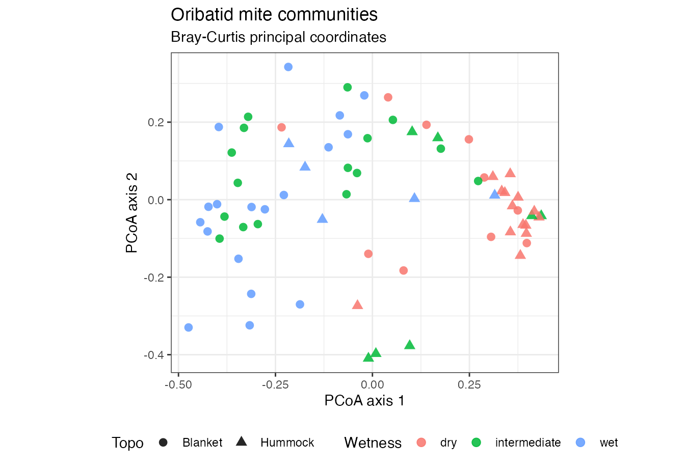
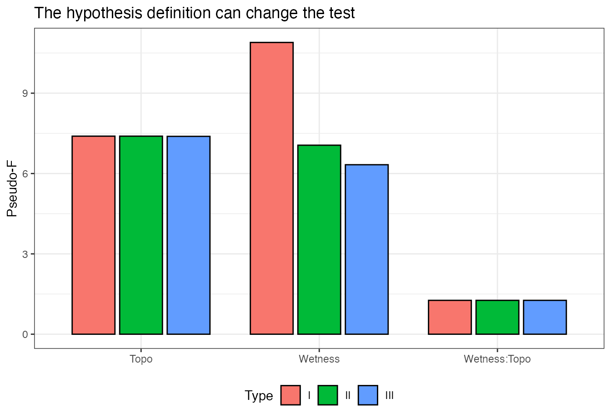

# 2. Fixed effects and Contrasts (Type I-II-III)

Fixed effects describe systematic differences in community composition
(e.g.  habitat, treatment, season, environmental gradients, and their
interactions)

Type I, II, and III specify different questions when predictor subspaces
overlap. In a perfectly orthogonal design they coincide; with unequal
cells, correlation, or interactions they need not.

### Choosing the type

- **Type I:** order represents a planned sequence of adjustment.
- **Type II:** main effects are interpreted marginally while respecting
  their containing interactions.
- **Type III:** each term is tested conditional on every other estimable
  term.

Note: This approach differs from the most mixed-models: Base `lme4`
reports fixed-effect coefficients with Wald t-values via
[`summary()`](https://rdrr.io/r/base/summary.html) (i.e. not an ANOVA
table) — while `lme4::anova()` on an lmer model returns sequential (Type
I) F-tests. `lmerTest` returns Type III ANOVA tables by default (with
Satterthwaite degrees of freedom), and
[`car::Anova()`](https://rdrr.io/pkg/car/man/Anova.html) takes an
explicit `type = "II"` or `type = "III"`.
[`permanova()`](https://marine-ecologist.github.io/distmer/dev/reference/permanova.md)
makes the choice explicit rather than defaulting, because on unbalanced
designs the three types give genuinely different answers and no default
is universally correct.

### Example: Mite communities along environmental gradients

The
[`vegan::mite`](https://vegandevs.github.io/vegan/reference/mite.html)
data contain 35 oribatid mite taxa from 70 samples. For a compact
factorial example the recorded topographic class is combined with
tertiles of water content. Water content is categorised into three
groups: `dry`, `intermediate`, and `wet`.

``` r

data(mite, mite.env, package = "vegan")
mite_bray <- vegdist(mite, method = "bray")

breaks <- quantile(mite.env$WatrCont, c(0, 1/3, 2/3, 1))
env <- transform(
  mite.env,
  Wetness = cut(
    WatrCont, breaks = breaks, include.lowest = TRUE,
    labels = c("dry", "intermediate", "wet")
  ),
  Topo = droplevels(factor(Topo))
)
with(env, table(Wetness, Topo)) |> tab()
```

|              | Blanket | Hummock |
|:-------------|--------:|--------:|
| dry          |      10 |      14 |
| intermediate |      16 |       7 |
| wet          |      18 |       5 |

All six combinations occur, but their sample sizes differ. The
ordination suggests that both predictors may contribute to composition:

``` r

ord <- as.data.frame(cmdscale(mite_bray, k = 2))
names(ord) <- c("Axis1", "Axis2")
ord$Wetness <- env$Wetness
ord$Topo <- env$Topo

ggplot(ord, aes(Axis1, Axis2, colour = Wetness, shape = Topo)) +
  geom_point(size = 2.6, alpha = 0.85) +
  labs(
    title = "Oribatid mite communities",
    subtitle = "Bray-Curtis principal coordinates",
    x = "PCoA axis 1", y = "PCoA axis 2"
  ) +
  theme_bw() + 
  coord_fixed() +
  theme(legend.position = "bottom")
```



### Type selection

**Type I: a sequential question** asks what each term adds at the point
where it enters the formula. The question is explicitly ordered. This is
used when order expresses the scientific model: for example, adjust for
a pre-treatment gradient before asking what treatment adds.
Unsurprisingly, don’t choose an order because it produces the smaller
p-value.

**Type II: population effects respecting marginality** tests each main
effect after adjusting for the other main effects, but not for
interactions containing that effect. In an additive model it gives the
question “what does this predictor add after the other predictors?” and
is invariant to formula order. Type II is often a sensible default for
ecological main effects when unequal cell counts are incidental and the
interaction is not the main target.

**Type III: each term conditional on every other term** tests each
effect after accounting for every other term in the model, including
interactions involving that effect. A main effect is then a contrast at
the reference implied by the factor coding. With interactions this
requires sum-to-zero contrasts;
[`permanova()`](https://marine-ecologist.github.io/distmer/dev/reference/permanova.md)
applies them to a copy of the data so the original data frame is not
modified.

- Type I:
- Type II:
- Type III:

``` r

wetness_first <- permanova(mite_bray ~ Wetness * Topo, env, 
                           type = "I", 
                           permutations = 999, 
                           seed = 101)

wetness_first$table[1:3, c("Source", "df", "Pseudo-F", "P(perm)")] |> tab()
```

| Source       |  df | Pseudo-F | P(perm) |
|:-------------|----:|---------:|--------:|
| Wetness      |   2 |   10.895 |   0.001 |
| Topo         |   1 |    7.396 |   0.001 |
| Wetness:Topo |   2 |    1.265 |   0.194 |

Or with topography first:

``` r

topography_first <- permanova(mite_bray ~ Topo * Wetness, env, 
                              type = "I", 
                              permutations = 999, 
                              seed = 101)

topography_first$table[1:3, c("Source", "df", "Pseudo-F", "P(perm)")] |> tab()
```

| Source       |  df | Pseudo-F | P(perm) |
|:-------------|----:|---------:|--------:|
| Topo         |   1 |   15.069 |   0.001 |
| Wetness      |   2 |    7.059 |   0.001 |
| Topo:Wetness |   2 |    1.265 |   0.194 |

``` r

fit_II <- permanova(mite_bray ~ Wetness * Topo, env,
                    type = "II", 
                    permutations = 999, 
                    seed = 101)

fit_II$table[1:3, c("Source", "df", "Pseudo-F", "P(perm)")]  |> tab()
```

| Source       |  df | Pseudo-F | P(perm) |
|:-------------|----:|---------:|--------:|
| Wetness      |   2 |    7.059 |   0.001 |
| Topo         |   1 |    7.396 |   0.001 |
| Wetness:Topo |   2 |    1.265 |   0.194 |

``` r

fit_III <- permanova(mite_bray ~ Wetness * Topo, env, 
                     type = "III", 
                     permutations = 999, 
                     seed = 101)

fit_III$table[1:3, c("Source", "df", "Pseudo-F", "P(perm)")] |> tab()
```

| Source       |  df | Pseudo-F | P(perm) |
|:-------------|----:|---------:|--------:|
| Wetness      |   2 |    6.329 |   0.001 |
| Topo         |   1 |    7.388 |   0.001 |
| Wetness:Topo |   2 |    1.265 |   0.194 |

### Comparing Types:

The three definitions can be compared directly:

``` r

fits <- list(I = wetness_first, II = fit_II, III = fit_III)
comparison <- do.call(rbind, lapply(names(fits), function(type) {
  tab <- fits[[type]]$table
  keep <- is.finite(tab$`Pseudo-F`)
  data.frame(
    Type = type, Term = tab$Source[keep],
    PseudoF = tab$`Pseudo-F`[keep], P = tab$`P(perm)`[keep]
  )
}))

ggplot(comparison, aes(Term, PseudoF, fill = Type)) +
  geom_col(position = position_dodge(width = 0.8), color="black", width = 0.72) +
  labs(
    title = "The hypothesis definition can change the test",
    x = NULL, y = "Pseudo-F"
  ) +
  theme_bw() +
  theme(legend.position = "bottom")
```



### Keep continuous predictors continuous

Ordinary numeric covariates can be combined with factors. Here water
content and substrate density remain on their measured scales:

``` r

gradient_fit <- permanova(mite_bray ~ Topo + WatrCont + SubsDens,
                          data = env,
                          type = "II", 
                          permutations = 999, 
                          seed = 101)

gradient_fit$table[1:3, c("Source", "df", "Pseudo-F", "P(perm)")]  |> tab()
```

| Source   |  df | Pseudo-F | P(perm) |
|:---------|----:|---------:|--------:|
| Topo     |   1 |    7.449 |   0.001 |
| WatrCont |   1 |   15.632 |   0.001 |
| SubsDens |   1 |    5.999 |   0.001 |

Note: Standardising a predictor changes its coefficient scale but not
the subspace tested by a one-degree-of-freedom term. Transformations
that change ordering or linearity can change the ecological hypothesis
and should be justified.
