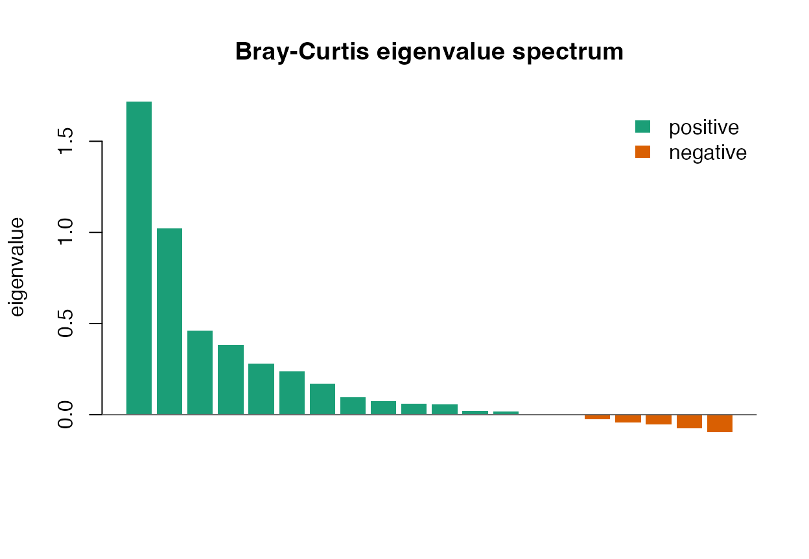

# 5. Atypical distance matrices

Many ecological dissimilarities are *semimetric*: they do not embed in
Euclidean space, so the Gower-centred matrix has negative eigenvalues.
`distmer` works with the Gower-centred matrix directly and **retains the
entire eigenvalue spectrum** – negative eigenvalues are reported, never
silently discarded. The geometry can be inspected and corrections can be
treated as an explicit sensitivity analyses (rather than invisible
cleanup).

## Inspecting the spectrum

[`distance_diagnostics()`](https://marine-ecologist.github.io/distmer/dev/reference/distance_diagnostics.md)
summarises whether a dissimilarity is Euclidean and how much inertia
sits on the negative axes.

``` r

bray <- vegdist(dune, method = "bray")
diag_bray <- distance_diagnostics(bray)
unlist(diag_bray[c("euclidean", "positive_inertia", "negative_inertia",
                    "negative_count", "negative_ratio")])
#>        euclidean positive_inertia negative_inertia   negative_count 
#>       0.00000000       4.59394690       0.29492503       5.00000000 
#>   negative_ratio 
#>       0.06419861
```

``` r

eig <- diag_bray$eigenvalues
barplot(
  eig, border = NA, names.arg = NULL,
  col = ifelse(eig >= 0, "#1b9e77", "#d95f02"),
  main = "Bray-Curtis eigenvalue spectrum", ylab = "eigenvalue"
)
abline(h = 0, col = "grey40")
legend("topright", c("positive", "negative"),
       fill = c("#1b9e77", "#d95f02"), border = NA, bty = "n")
```



A non-zero negative fraction is not an error: `distmer` uses the
complete pseudo-Euclidean representation for its sums of squares and
permutation tests, so the reported pseudo-F and p-value are valid for
the dissimilarity you chose.

## Corrections are separate analyses

A transformation or eigenvalue correction changes the dissimilarity, and
therefore the hypothesis. Report it *alongside* the original with the
same seed, never as a silent replacement. A square-root transform, for
example, often makes Bray-Curtis closer to Euclidean:

``` r

sqrt_bray <- sqrt(bray)
raw  <- permanova(bray ~ Management, dune.env, permutations = 199, seed = 1)
sqrt_fit <- permanova(sqrt_bray ~ Management, dune.env, permutations = 199, seed = 1)
rbind(
  `Bray-Curtis`      = raw$table[1, c("Pseudo-F", "P(perm)")],
  `sqrt Bray-Curtis` = sqrt_fit$table[1, c("Pseudo-F", "P(perm)")]
)
#>                  Pseudo-F P(perm)
#> Bray-Curtis      2.767243   0.005
#> sqrt Bray-Curtis 1.979245   0.005
```

``` r

distance_diagnostics(sqrt_bray)[c("euclidean", "negative_ratio")]
#> $euclidean
#> [1] TRUE
#> 
#> $negative_ratio
#> [1] 0
```

Lingoes and Cailliez corrections deserve the same treatment: they add a
constant to the dissimilarities to remove negative eigenvalues, so
present them as an explicit alternative analysis, not a default.

## When the geometry matters

The negative fraction is worth reporting because it bounds how much of
the structure lives outside ordinary Euclidean intuition. A small
negative fraction (as above) means a Euclidean approximation would
change little; a large one means ordination plots and any
Euclidean-embedding step should be read cautiously. Pair this diagnostic
with the dispersion check in `vignette("dispersion")` before
interpreting a location test.
