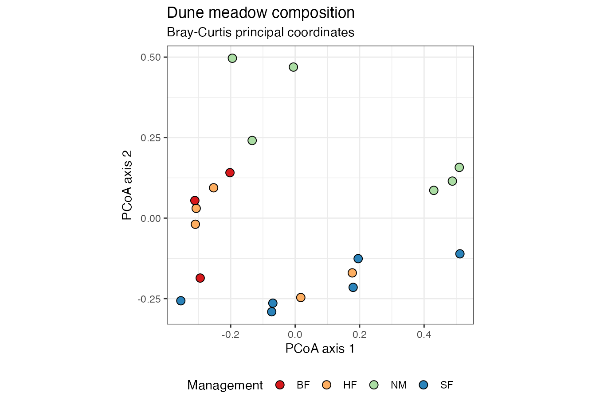

# 1. Getting started with distmer

## What is distmer?

`distmer` is a framework for **distance-based mixed-effects models with
permutational inference**. It combines two ideas that are already
familiar to many ecologists:

1.  PERMANOVA’s partitioning of community variation in the space defined
    by a chosen dissimilarity; and
2.  mixed-model formula notation for describing fixed effects,
    experimental units, nesting, blocks, repeated sampling, and random
    slopes.

The formula looks like an `lmer()` formula, but `distmer` is not a
likelihood or REML wrapper around `lme4`. It works from a dissimilarity
matrix. Fixed terms describe the ecological effects of interest; random
terms identify the experimental units and covariance strata that
determine a valid denominator and permutation action.

This gives two useful reference points:

- without random effects, a supported `distmer` model reduces to
  conventional PERMANOVA;
- with a univariate Euclidean response, supported designs reproduce
  their classical linear- or mixed-model tests.

The aim is therefore not to detach the method from PERMANOVA. It is to
make distance-based inference within a mixed-model workflow while
keeping the denominator and exchangeability assumptions visible.

## Example: a dune meadow community model

The
[`vegan::dune`](https://vegandevs.github.io/vegan/reference/dune.html)
data contain plant abundances from 20 dune meadows. We will ask whether
community composition differs among management regimes.

``` r

data(dune, dune.env, package = "vegan")
bray <- vegdist(dune, method = "bray")
table(dune.env$Management)
#> 
#> BF HF NM SF 
#>  3  5  6  6
```

PCoA:

``` r

points <- as.data.frame(cmdscale(bray, k = 2))
names(points) <- c("Axis1", "Axis2")
points$Management <- dune.env$Management

ggplot(points, aes(Axis1, Axis2, fill = Management)) +
  geom_point(size = 3, shape=21) +
  labs(
    title = "Dune meadow composition",
    subtitle = "Bray-Curtis principal coordinates",
    x = "PCoA axis 1", y = "PCoA axis 2"
  ) +
  theme_bw() + 
  scale_fill_brewer(palette="Spectral") +
  coord_fixed() +
  theme(legend.position = "bottom")
```



Using `distmer`, the dissimilarity matrix is placed on the left of the
formula, just as the response would be in
[`lm()`](https://rdrr.io/r/stats/lm.html) or `lmer()`:

``` r

fit <- permanova(
  bray ~ Management,
  data = dune.env,
  permutations = 999,
  seed = 2026
)
fit$table |> tab()
```

| Source     |  df |    SS |    MS | Pseudo-F | P(perm) | P(MC) | Unique perms |
|:-----------|----:|------:|------:|---------:|--------:|------:|-------------:|
| Management |   3 | 1.469 | 0.490 |    2.767 |   0.004 | 0.004 |          999 |
| Residual   |  16 | 2.830 | 0.177 |       NA |      NA |    NA |           NA |
| Total      |  19 | 4.299 |    NA |       NA |      NA |    NA |           NA |

`Pseudo-F` measures the separation attributable to management relative
to the appropriate residual variation. `P(perm)` is the proportion of
permitted null rearrangements at least as extreme as the observed value.
`P(MC)`, when shown, is a separately labelled asymptotic Monte-Carlo
reference; the design-aware permutation result remains the primary
inference.

For this fixed one-factor model, the observed statistic agrees with
[`vegan::adonis2()`](https://vegandevs.github.io/vegan/reference/adonis.html):

``` r

vegan_fit <- adonis2(bray ~ Management, data = dune.env, permutations = 0)
c(
  distmer = fit$table$`Pseudo-F`[1],
  vegan = vegan_fit$F[1]
)
#>  distmer    vegan 
#> 2.767243 2.767243
```

## Formula language

Fixed terms use ordinary R formula notation:

``` r

bray ~ management
bray ~ management + moisture
bray ~ management * season
bray ~ management + soil_pH
```

Random terms describe follow lmer notation:

``` r

bray ~ treatment + (1 | site)
bray ~ treatment + (1 | region/site)
bray ~ period + (1 + period | ditch)
```

## Additional guides:

1.  [`vignette("fixed-effects")`](https://marine-ecologist.github.io/distmer/dev/articles/fixed-effects.md):
    Type I, II, and III fixed-effect questions.
2.  [`vignette("contrasts")`](https://marine-ecologist.github.io/distmer/dev/articles/contrasts.md):
    planned contrasts, pairwise comparisons, and multiplicity control.
3.  [`vignette("dispersion")`](https://marine-ecologist.github.io/distmer/dev/articles/dispersion.md):
    distance diagnostics and multivariate dispersion.
4.  `vignette("unbalanced-mixed")`: unequal cells and unequal
    replication.
5.  [`vignette("random-effects")`](https://marine-ecologist.github.io/distmer/dev/articles/random-effects.md):
    random intercepts, nesting, blocks, and random slopes, including how
    [`permanova()`](https://marine-ecologist.github.io/distmer/dev/reference/permanova.md)
    represents them internally.
6.  [`vignette("validation")`](https://marine-ecologist.github.io/distmer/dev/articles/validation.md):
    reproducible analyses and independent checks.
